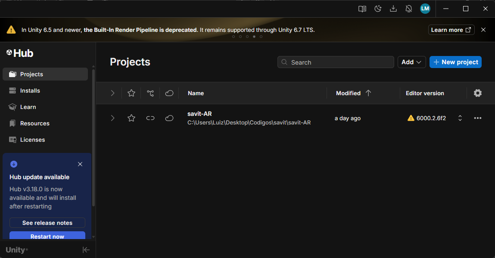
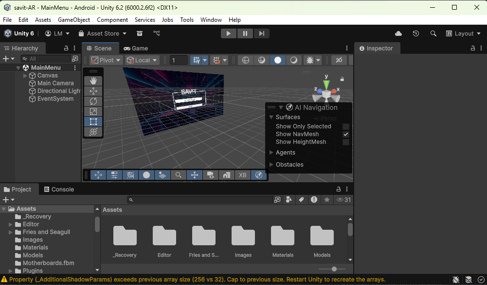
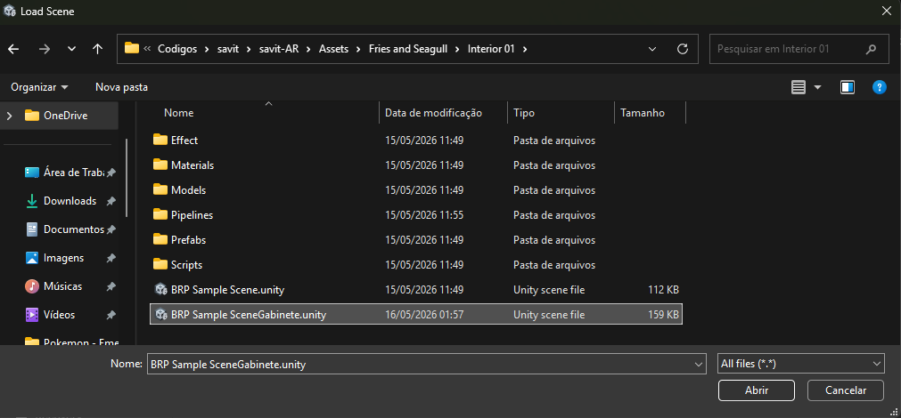
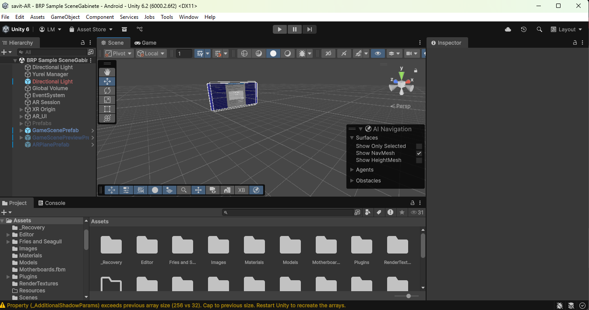
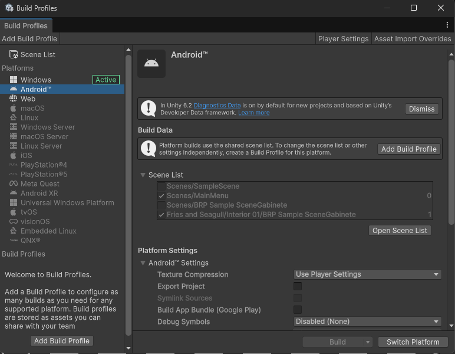

# PROJETO SAVIT

<p align="center">
  
</p>

O Projeto SAVIT (Sistema de Aprendizado Virtual de Infraestrutura de T.I.) é um jogo que guia você no aprendizado de conteúdos sobre computadores, DVR, firewalls, UniFi, entre outros temas do universo de redes e infraestrutura.

## Integração com o backend

O aplicativo Unity utiliza a API do SAVIT publicada no API Gateway:

```text
https://ihrws12500.execute-api.us-east-1.amazonaws.com/default
```

O backend é executado por funções AWS Lambda e usa o Supabase exclusivamente no servidor para persistir perfis, runs, pontuações e ranking. Nenhuma chave privada do Supabase deve ser incluída no projeto Unity.

### Rotas utilizadas

| Método | Rota | Autenticação | Função |
|---|---|---|---|
| `POST` | `/user` | Não | Cria o perfil com `username`, `email` e `password`. |
| `POST` | `/auth` | Não | Valida e-mail e senha e retorna um JWT e o perfil. |
| `POST` | `/runs` | `Authorization: Bearer <JWT>` | Grava uma run e seus scores no Supabase. |
| `GET` | `/runs/ranking` | `Authorization: Bearer <JWT>` | Retorna o ranking global. |
| `GET` | `/runs/user/{userId}` | `Authorization: Bearer <JWT>` | Retorna o histórico do usuário autenticado. |

O controller da rota de runs recebe o payload consolidado abaixo. O `user_id` enviado pelo aplicativo também é validado/substituído pelo usuário identificado no JWT no backend:

```json
{
  "runData": {
    "user_id": "uuid-do-usuario",
    "started_at": "2026-11-01T18:19:44.138Z",
    "finished_at": "2026-11-01T18:20:24.700Z",
    "status": "finished",
    "total_points": 460,
    "total_errors": 4,
    "app_version": "0.5.0"
  },
  "scoresData": [
    { "points": 80, "stage": "ram" },
    { "points": 100, "stage": "motherboard" }
  ]
}
```

Cada componente concluído começa com 100 pontos e perde 10 pontos por erro, sem ficar abaixo de zero. A run só é enviada ao terminar ou abandonar a partida; o backend grava a run e os scores relacionados em uma operação.

## Demonstração

Assista a uma demonstração prática do projeto em funcionamento no vídeo abaixo:

[](https://www.youtube.com/watch?v=Ej5gLzyrLUE)

## Como Utilizar
O software ainda está em desenvolvimento. Você pode:

- Baixar e instalar o APK (recomendado para testes rápidos).
- Rodar o projeto no Unity (modo de desenvolvimento).

### Baixar APK
O APK fica disponível nas Releases do GitHub:

- https://github.com/Orbi-SP/savit-AR/releases

### CI/CD e publicação automática do APK

O projeto possui um workflow do GitHub Actions em
[`.github/workflows/build-android.yml`](./.github/workflows/build-android.yml) que executa o build
Android com o Unity **6000.2.6f2**. O fluxo:

1. É executado a cada push na branch `main`, por uma tag de versão (`v1.2.3` ou `V1.2.3`) ou manualmente pelo GitHub Actions.
2. Lê a versão definida no `bundleVersion` em `ProjectSettings/ProjectSettings.asset`.
3. Faz o build do APK Android usando o `game-ci/unity-builder`.
4. Salva o APK como artefato do workflow por 14 dias.
5. Cria uma GitHub Release e anexa o APK com o nome `savit-vX.Y.Z.apk` quando a versão ainda não possui uma tag correspondente.

Para publicar uma nova versão automaticamente, altere o campo `bundleVersion` no
Unity em **Edit > Project Settings > Player > Other Settings > Identification > Version**
e envie a alteração para a `main`. O valor deve seguir o formato `MAJOR.MINOR.PATCH`,
por exemplo `0.0.2`. O workflow cria a tag `v0.0.2` e a release correspondente. Também
é possível publicar diretamente enviando uma tag como `v1.2.3`.

O repositório precisa ter os secrets `UNITY_LICENSE`, `UNITY_EMAIL` e
`UNITY_PASSWORD` configurados em **Settings > Secrets and variables > Actions**. A
release é criada com as permissões de conteúdo configuradas pelo próprio workflow.

### Rodar no Unity (modo de desenvolvimento)
Para executar no Unity, você precisará dos itens abaixo:

- **Unity Engine (Unity Hub)**: necessário para abrir e executar o projeto.
- **Internet**: o Unity vai baixar dependências via UPM (Unity Package Manager) na primeira abertura.
- **Git**: necessário para o UPM baixar o pacote do MediaPipe (dependência via Git).

Após clonar o repositório, você não precisa criar um projeto novo no Unity.

1) Abra o projeto diretamente no Unity Hub:
- No Unity Hub, clique em **Add** (Adicionar)
- Selecione a pasta raiz deste repositório (a pasta que contém `Assets/`, `Packages/` e `ProjectSettings/`)



2) O projeto inicia, primeiramente, na cena do menu.




- Para ir para a cena da gameplay do projeto, aperte CTRL+O, vá até a pasta `savit-AR\Assets\Fries and Seagull\Interior 01` e selecione `BRP Sample SceneGabinete.unity`.



3) Agora você estará na cena em que a gameplay acontece.



- Agora é necessário trocar o build para Android (caso ainda não esteja). Aperte CTRL+SHIFT+B, selecione Android e clique em **Switch Platform**.
- Se o módulo de Android não estiver instalado, o próprio Unity vai indicar como baixar/instalar.



4) Conecte o celular via USB no computador e deixe o aparelho com **Opções do Desenvolvedor** e **Depuração USB** ativadas.
- Depois, aperte CTRL+B para buildar.
- Siga as janelas do Unity e, no celular, aceite a instalação do APK.

Para acompanhar futuras atualizações, acesse nossa landing page: https://orbi-sp.github.io/landing-page/

MediaPipe utilizado (UPM/Git, tag v0.16.3): https://github.com/homuler/MediaPipeUnityPlugin.git?path=Packages/com.github.homuler.mediapipe#v0.16.3
Referência do pacote no repositório: https://github.com/homuler/MediaPipeUnityPlugin/tree/v0.16.3/Packages/com.github.homuler.mediapipe

Obs.: o Unity Package Manager não aceita URL direta para arquivos `.tgz`. Por isso o pacote é baixado via Git, e os binários necessários para Android/Protobuf ficam versionados em `Assets/Plugins/`.

Para configurar autenticação, orientação da tela, gravação de runs e pontuação no Unity 6000.2.6f2, consulte o [guia de configuração](SETUP_UNITY.md).
